# Teaching a small LLM to draw in N shapes: SFT and RL post-training, for beginners

This repo is a complete, small post-training project, written up as I ran it: one experiment at a time, each with a prediction, a result, and a decision about what to try next. There are almost no equations. The point is to show what actually happens when you fine-tune a language model and then train it with reinforcement learning (RL), including the parts that didn't work.

**The task:** give Qwen3-1.7B the name of an object and a shape budget, for example *"broom, at most 3 shapes"*, and have it write SVG code for a drawing that someone could recognize.

**The short version:**

| SigLIP 2 usable top-1 (higher is better) | Objects the model trained on | New objects |
|---|---|---|
| Qwen3-1.7B, no training | 1.0% | 1.6% |
| SFT on 100 human sketches per object | 3.7% | 0.9% |
| SFT on 1,000 human sketches per object | 26.6% | 1.5% |
| **SFT + RL** | **30.2%** | **1.0%** |
| Human sketches (the realistic ceiling) | ~44% | 37–43% |

Supervised fine-tuning (SFT) on enough human sketches does most of the work, and RL adds a little more. Neither teaches the model to draw objects it has never seen drawn.

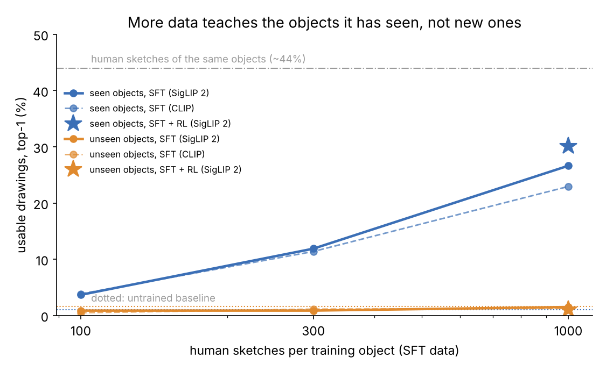

---

## 1. The task

The model gets this prompt, with only the object and the number changing:

```
Draw the following subject as an SVG image: broom

Rules:
- Use at most 3 shapes. Shape elements are <circle>, <ellipse>, <rect>, <line>, <polyline>, <polygon> and <path>.
  Every subpath of a <path> (each M or m command) counts as one shape.
- Do not use <text>, <image>, <use>, <style>, patterns, filters, masks or clip paths.

Reply with only the SVG code.
```

A "shape" is one element, not one straight line. A single `<polyline>` can have as many points as you like, so one shape can trace a whole outline. The budget limits how many separate pieces a drawing has, not how detailed each piece is. Budgets are 3, 6 and 12.

The objects are the 345 categories from Google's [Quick, Draw!](https://github.com/googlecreativelab/quickdraw-dataset). I removed 14 that make poor prompts: shapes that one element solves perfectly ("circle," "zigzag"), abstract ideas ("camouflage"), and famous landmarks ("The Mona Lisa"). The reasons are in [`prompts/exclusions.tsv`](prompts/exclusions.tsv). The remaining 331 were split **by object** into 199 training, 66 validation and 66 test objects. Splitting by object, not by prompt, means the model is never evaluated on an object it trained on, so a good validation score can't come from memorizing.

## 2. How "good" is measured

A drawing is **usable** only if it passes two layers.

**Layer 1, the gate** ([`svgbudget/gate.py`](svgbudget/gate.py)) is plain code. It finds the SVG in the answer, parses it, rejects any element not on an allowlist, counts shapes against the budget, renders the drawing, and rejects blank canvases (under 1% ink). Every drawing gets exactly one result: `ok`, or the first rule it broke. Each rule closes a shortcut. For example, every subpath of a `<path>` counts as a shape; otherwise the model could pack a whole drawing into one path and ignore the budget.

**Layer 2, the judge** ([`svgbudget/judges.py`](svgbudget/judges.py)) is a vision model that sees **only the image**, never the prompt, and has to pick the right object out of all 331. That's a blind identification test: there's no single correct drawing of a broom, but a recognizable one should be identifiable.

The **usable rate** is the share of *all* outputs that pass the gate *and* whose true object is the judge's first choice. Failed drawings count against the score.

## 3. Setup

The model is [Qwen3-1.7B](https://huggingface.co/Qwen/Qwen3-1.7B) in non-thinking mode, with its recommended sampling settings (temperature 0.7, top-p 0.8, top-k 20). Every experiment ran on a single A100 80 GB GPU; the machine had 8, which let independent runs go in parallel. Every model is evaluated with one script ([`scripts/06_evaluate.py`](scripts/06_evaluate.py)) on two fixed sets:

| | Objects | Budgets | Samples per prompt | Drawings |
|---|---|---|---|---|
| **New objects** (the generalization test) | 66 validation objects | 3, 6, 12 | 4 | 792 |
| **Seen objects** (did it learn what it trained on?) | 199 training objects | 3, 6, 12 | 1 | 597 |

Generation is fully repeatable: rerunning the same model with the same seeds gave identical drawings, token for token. So differences between models come from the models, not from sampling luck.

## 4. The baseline: valid SVG, but you can't tell what it is

Without any training, Qwen writes well-formed SVG almost every time. **78% of its drawings pass the gate.** The rest mostly use one shape too many (13.5%), or come out blank (7.6%). The blank ones have a funny cause: the model draws a shape in black, then the *identical* shape in white on top of it, which covers it completely.

The drawings themselves are a different story. I picked 20 random valid ones and tried to name them blind. I got **0 of 20.** The four judges agreed: SigLIP 2 recognized 1.6% of outputs, CLIP 0.6%, about the same as random shapes.

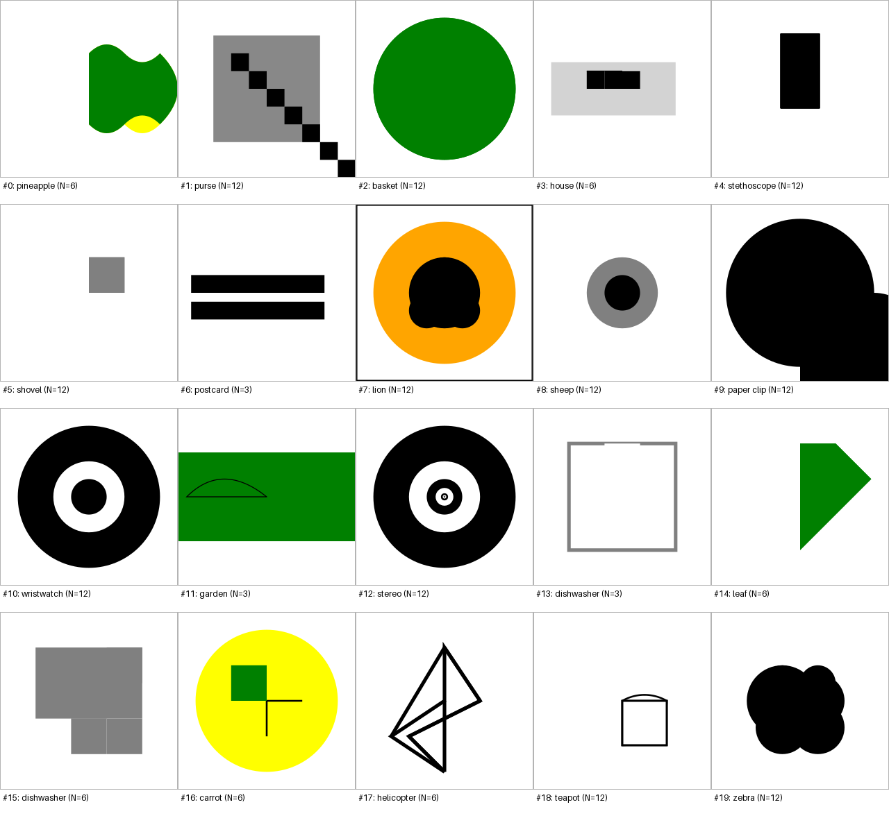

The very first drawing, a "bicycle" in 6 shapes, sums up the baseline: a frame around the canvas plus a box built out of four separate lines. It follows every rule, uses no circles, and looks nothing like a bicycle.

## 5. Can the judges be trusted?

A judge that fails on good drawings would make every score meaningless, so I tested the judges before using them ([`scripts/03_calibrate_judges.py`](scripts/03_calibrate_judges.py)).

**Positive control:** 660 real human sketches of the validation objects from Quick, Draw!. **Negative control:** 300 drawings of random colored shapes with random labels. A good judge should do well on the first and score near chance (0.3%) on the second.

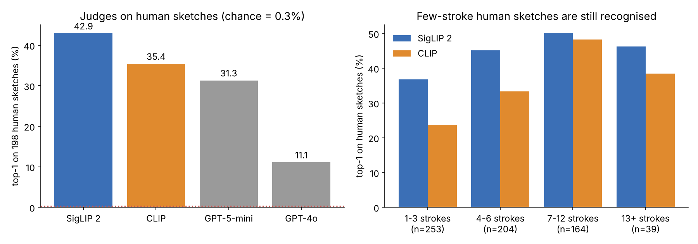

SigLIP 2 recognizes 43% of human sketches and CLIP 34%. Both are near chance on random shapes. Neither is perfect, because many objects are close neighbors ("cup," "coffee cup," "mug") and quick sketches are crude. But both easily separate good drawings from bad ones, and that's what matters for comparisons.

I also tried two GPT models through Azure as judges, expecting them to be stronger. They weren't. GPT-5-mini matched CLIP (31%), and GPT-4o managed only 11%, whichever answer format I used, so the format wasn't the cause. In the end the project used only the two local judges, and the Azure code isn't included here. **SigLIP 2 gives the RL reward, and CLIP is the independent check that RL never trains on.**

**Is the task even possible?** Human sketches with only 1–3 strokes are still recognized 37% of the time by SigLIP 2 (right chart). So recognizable drawings within these budgets clearly exist. The baseline's 1.6% is the model's problem, not the task's.

## 6. A free try first: thinking mode

Qwen3 can reason before answering, which costs nothing to try. On a small pilot (66 drawings at N = 6), the usable rate rose from 2.3% to 6.1%, but that's only 4 drawings, and each answer took 3,646 tokens instead of about 200, making it roughly 50 times slower. The reasoning was sensible ("a body, wings, maybe a face... a circle for the head") but the SVG it then wrote didn't follow its own plan. **The model knows what objects consist of; it can't turn that into coordinates.** The full thinking run ran out of GPU memory at 8,192 tokens per answer, and I stayed with non-thinking mode from then on.

## 7. SFT on human sketches

**The data.** Each Quick, Draw! sketch is a list of pen strokes, and comes with the word the person was asked to draw. I converted each stroke into one `<polyline>` on a 0–100 canvas with whole-number coordinates ([`svgbudget/sketches.py`](svgbudget/sketches.py)). Whole numbers matter because Qwen's tokenizer gives every digit its own token: `16.3` costs 4 tokens. One stroke is one shape, so a sketch's stroke count is its shape count. Each sketch is paired with **one random budget it fits**: a 2-stroke sketch might be the answer for N = 3, 6 or 12. That teaches "at most N," not "exactly N." Each SFT example is simply *the evaluation prompt* (object word + budget), with the human sketch as the answer.

**The training:** LoRA adapters (about 1% of the weights) on every layer, learning rate 2e-4, batches of 16, 2 epochs ([`svgbudget/sft.py`](svgbudget/sft.py)). Only the answer tokens are trained, including the end-of-answer token, so the model also learns when to stop.

**SFT v1 (100 sketches per object) changed the style completely** and broke something new. The drawings became hand-drawn outlines, over-budget failures fell from 107 to 28, and blanks from 60 to 2. But **45% of outputs never finished**: they ran to the 1,024-token limit. The cause, found by reading the outputs: the model would start a round shape and keep circling, adding points to the same line forever. Ending a circle requires noticing you're back at the starting point, 50–100 tokens earlier, and the training loss mostly rewards predicting each point from the previous one.

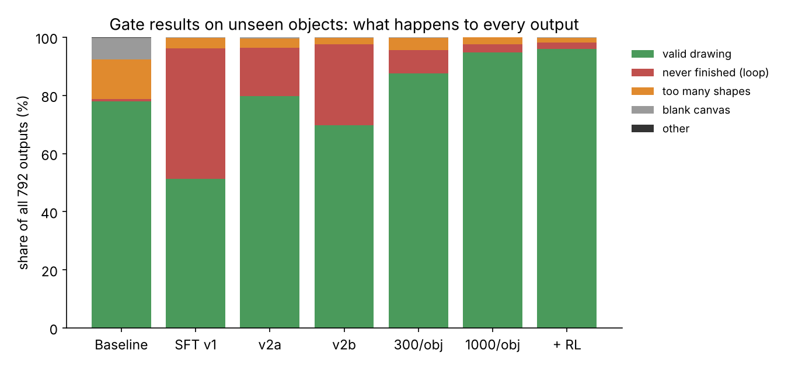

Two fixes were tested side by side, each changing one thing:

| | SFT v1 | v2a: simplified strokes | v2b: drop strokes over 40 points |
|---|---|---|---|
| Never finished | 356 of 792 | **132** | 221 |
| Gate pass | 51.3% | **79.7%** | 69.7% |

Simplifying every stroke (the Ramer–Douglas–Peucker algorithm, tolerance 2 units) worked better than removing only the extreme ones, and it made drawings 27% shorter. It barely changes how they look:

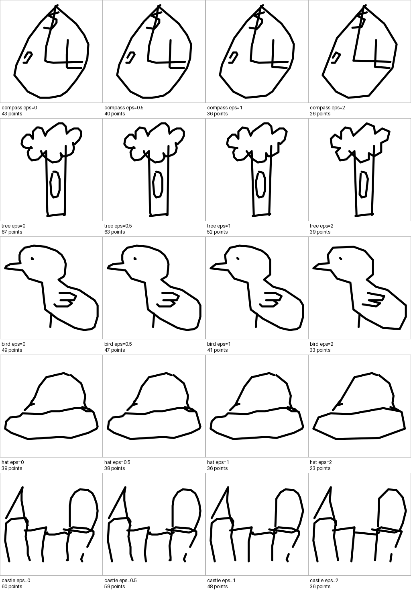

## 8. "It looks like a sketch, but of the wrong thing"

v2a drew convincing hand-drawn sketches, valid 80% of the time. Yet recognizability on new objects was still near zero (0.9%). Looking at the drawings, they seemed readable; the labels just seemed wrong. I suspected a bug that mixed up labels somewhere, and checked every stage:

- **Training data:** SigLIP 2 matches training sketches to their own labels 42–46% of the time, the same as human sketches in general. The pairing is correct.
- **Evaluation:** every saved image was re-rendered from its own record and compared pixel by pixel. 0 mismatches.
- **Not drawing a different known object:** for a given request, the judge's guesses varied from drawing to drawing, and weren't biased toward training objects.

So there was no bug. The model had learned a **generic sketch vocabulary** (blobs, loops, rectangles, zigzags) and used it almost regardless of the word. The judges then named whatever generic object those shapes resembled ("map," "bracelet," "potato"). A direct test confirmed it: giving the model the *wrong* object name made its predictions only 4% worse on training objects, and 2% worse on new ones. Over 95% of what SFT taught had nothing to do with which object was requested.

One more learned habit showed up: **copied strokes.** 19% of v2a's drawings contained near-duplicates of a stroke, against 1% of human sketches. In one, the model spent 10 of its 12 shapes on the same vertical line, shifted one unit at a time.

## 9. Data scaling: the biggest effect in the project

The model saw only about 46 examples per object. The format appears in every example, but each object's appearance only 46 times. So I trained on more sketches per object, changing nothing else ([`scripts/04_build_sft_data.py`](scripts/04_build_sft_data.py) with `--per-category 300` and `1000`).

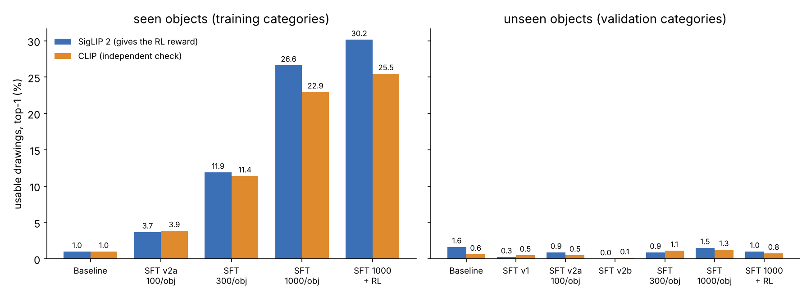

**On objects it trained on, recognizability climbed from 3.7% to 11.9% to 26.6%,** confirmed by both judges, reaching about 60% of what the human sketches themselves achieve. Validity rose to 95%, and truncation nearly vanished (132 → 64 → 22). **On new objects, nothing moved.** Ten times more examples per object taught *those* objects, not drawing in general.

The held-out loss shows the same split: the gap between seen and unseen objects widens as data grows.

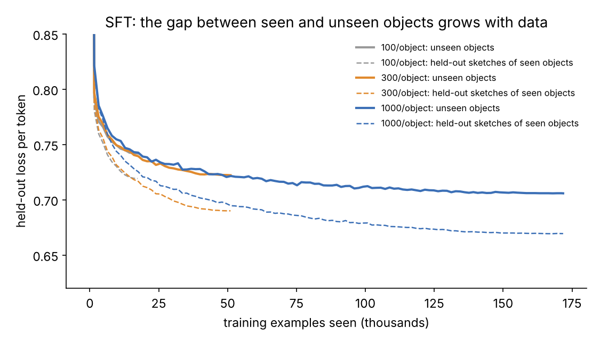

The same 8 prompts, drawn by every model, show the progression on seen objects:

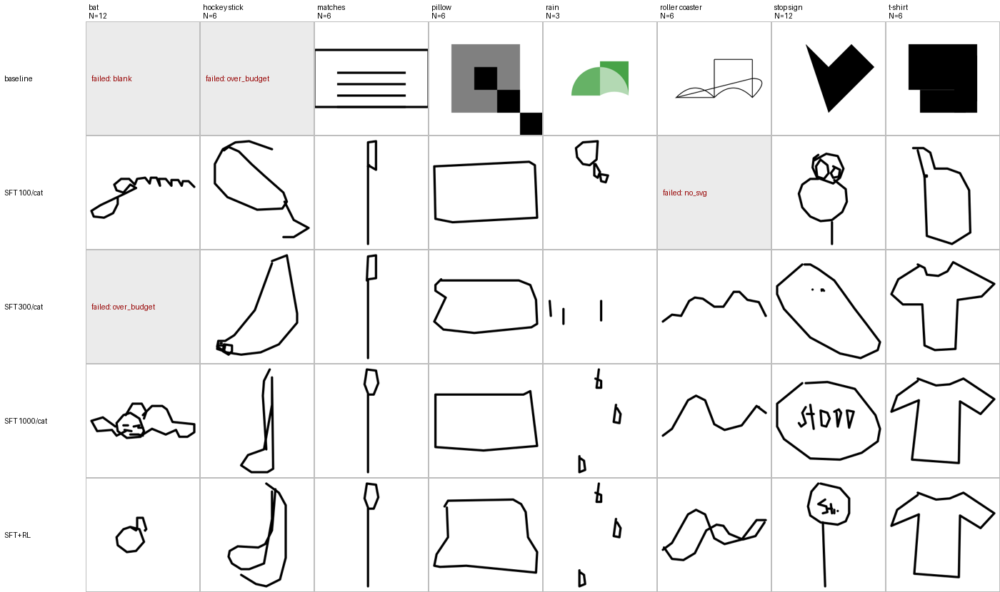

## 10. RL

**What RL does here.** For each prompt, the model draws 8 sketches. Each gets a reward for how recognizable it is. Drawings that scored *above their group's average* become more likely, and below-average ones less likely. That's GRPO-style training ([`svgbudget/rl.py`](svgbudget/rl.py)), starting from the 1,000-per-object SFT model and training only on training objects.

**The reward** is SigLIP 2's probability for the *correct* object, among all 331 (0 if the gate fails). It's graded, which matters: a near miss scores something, so RL has a direction even when no drawing is exactly right. Before training, I checked it ranks drawings sensibly: human sketches 0.366, SFT 0.231, baseline 0.011, random shapes 0.002.

**One deliberate change from standard GRPO: the advantage is reward minus the group mean, without dividing by the group's spread.** Here's why, with real rewards from one batch:

| Group | Rewards | Largest push, standard GRPO | Largest push, ours |
|---|---|---|---|
| palm tree | 0.00 0.92 0.00 0.01 0.76 0.04 0.00 0.00 | 1.94 | 0.70 |
| matches | 0.02 0.01 0.00 0.01 0.01 0.00 0.00 0.02 | **1.44** | **0.01** |

All eight matchstick drawings are unrecognizable; their differences are noise. Standard GRPO divides by their tiny spread and pushes on that noise almost as hard as on the palm tree's real success.

**Two checks before the real run.** (1) Does one update point the right way? After a single step, good drawings became more likely and bad ones less likely (correlation +0.82). A sign error here would silently train the model toward worse drawings. (2) How big is one step? At a learning rate of 1e-4, one step made a good drawing about 180 times more likely, far too much. I used **2e-6**, for changes of about 10% per step.

**The run:** 200 steps, 16 prompts × 8 drawings each, about 3 hours on one GPU.

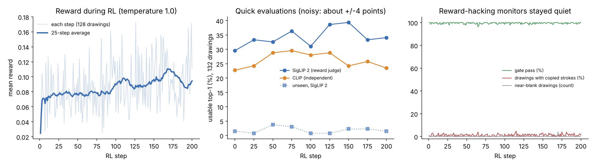

The training reward rose about 31% (0.076 → 0.100, comparing the first and last 50 steps), and the reward-hacking monitors stayed quiet: validity near 100%, no rise in near-blank drawings or copied strokes, steady drawing length. On the final evaluation:

| Seen objects (597 drawings) | SFT 1,000/object | SFT + RL | Change |
|---|---|---|---|
| SigLIP 2 usable top-1 (reward judge) | 26.6% | 30.2% | +3.6 |
| CLIP usable top-1 (independent) | 22.9% | 25.5% | +2.6 |
| SigLIP 2 top-5 | 44.6% | 49.2% | +4.6 |
| Gate pass | 94.5% | 96.3% | +1.8 |

**Honest reading:** every measure improved, on both judges, so RL helped. But with 597 drawings, two models can differ by about ±2.6 points from sampling alone, so each single gain is suggestive rather than proven. CLIP's gain is somewhat smaller than SigLIP 2's, and in the quick evaluations CLIP drifted back down toward the end while SigLIP 2 stayed up. That's a mild sign that part of the gain is specific to the reward judge. On new objects, RL changed nothing (1.5% → 1.0%, within noise).

The successes at the end of RL, and how each earlier model drew the same prompts:

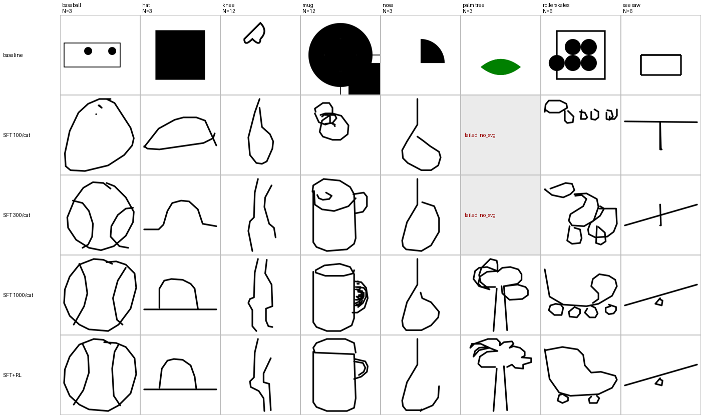

## 11. What didn't work: new objects

Every method left new objects at the baseline level, about 1%. The drawings did become more sketch-like, and sometimes the right *kind* of thing (a "lion" became a generic four-legged animal), but not the specific object:

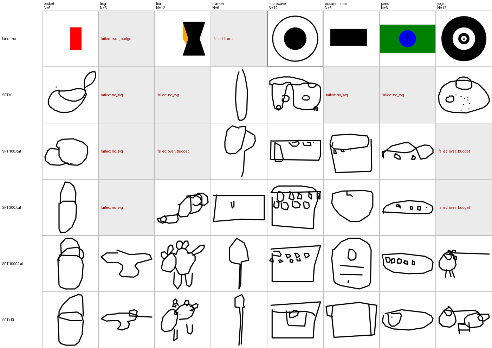

My reading: Qwen knows a lot *about* objects in words, as the thinking pilot showed, but a 1.7B text-only model has little practice turning that into spatial layout, and imitating 199 objects doesn't teach that as a general skill. Things that might change it, none tested here: far more object variety than Quick, Draw!'s 345 categories, a larger model, or a vision-language model that has seen what objects look like.

## 12. Lessons that would apply to any post-training project

- **Measure the baseline thoroughly first.** Here it showed the problem was recognizability, not validity, which set every later decision.
- **Calibrate the judge with controls** before trusting any number it gives, and report results next to a realistic ceiling.
- **Look at the outputs.** The endless circles, the black-under-white blanks and the copied strokes were all found by reading drawings, not from summary numbers.
- **Change one thing at a time,** and run variants in parallel when you have the hardware.
- **Check the data and pipeline before believing a surprising result.** The "label mismatch" suspicion was worth ruling out.
- **More data can beat a cleverer method.** Data scaling did far more than RL here.
- **For RL: test the direction of one update, size the learning rate from that test, keep an independent judge, and never let a monitor crash the training run.** Mine did once.

## Reproduce it

Install (Python 3.11; `libcairo2` is needed for rendering):

```bash
pip install -r requirements.txt
```

Then run the steps in order. Times are on one A100 80 GB.

```bash
python scripts/01_download.py                     # models, judges, sketches (~10 min)
python scripts/03_calibrate_judges.py             # judge controls (~2 min)
python scripts/06_evaluate.py --name eval_baseline                              # ~7 min
python scripts/06_evaluate.py --name eval_baseline_seen --split train --n-samples 1

python scripts/04_build_sft_data.py --name v1  --per-category 100
python scripts/04_build_sft_data.py --name v2a --per-category 100 --eps 2
python scripts/04_build_sft_data.py --name v2b --per-category 100 --max-points 40
python scripts/04_build_sft_data.py --name v3_300  --per-category 300  --eps 2
python scripts/04_build_sft_data.py --name v3_1000 --per-category 1000 --eps 2

python scripts/05_train_sft.py --name sft_v3_1000 --data v3_1000 --max-dev 500    # ~3 h (100/object: ~25 min)
python scripts/06_evaluate.py --name eval_sft_v3_1000 --adapter runs/<stamp>_sft_v3_1000/adapter

python scripts/07_train_rl.py --name rl_v1 --start sft_v3_1000                     # ~3 h
python scripts/06_evaluate.py --name eval_rl_v1 --adapter runs/<stamp>_rl_v1/adapter

python scripts/08_make_figures.py                 # every chart, from results/
```

`prompts/splits.json` is included, so `scripts/02_make_splits.py` is only needed to recreate it. Every script writes to its own `runs/<timestamp>_<name>/` folder, with its settings, git commit, GPU and package versions.

## What's in the repo

```
svgbudget/            the library: plain functions, one topic per file
  prompts.py          the prompt and the train/val/test split
  gate.py             layer 1: the rules
  judges.py           layer 2: blind identification, and the RL reward
  render.py           SVG -> image, image grids
  sketches.py         human sketches -> SFT examples
  model.py            loading Qwen and sampling drawings
  evaluate.py         the evaluation pipeline
  sft.py              SFT with LoRA
  rl.py               RL: rollouts, advantages, loss, training loop, monitors
  download.py, runlog.py, stats.py
scripts/              numbered steps, run in order
results/              every number in this README: evaluation summaries, training logs, judge calibration
figures/              every image in this README
prompts/              categories, exclusions, splits
```

Sketch data: Quick, Draw! by Google Creative Lab, released under CC BY 4.0.
